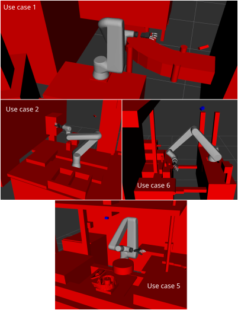
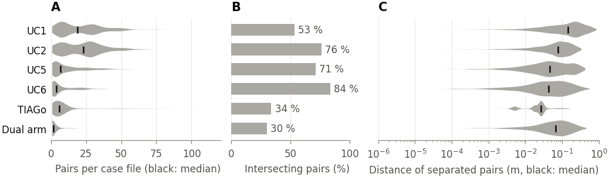
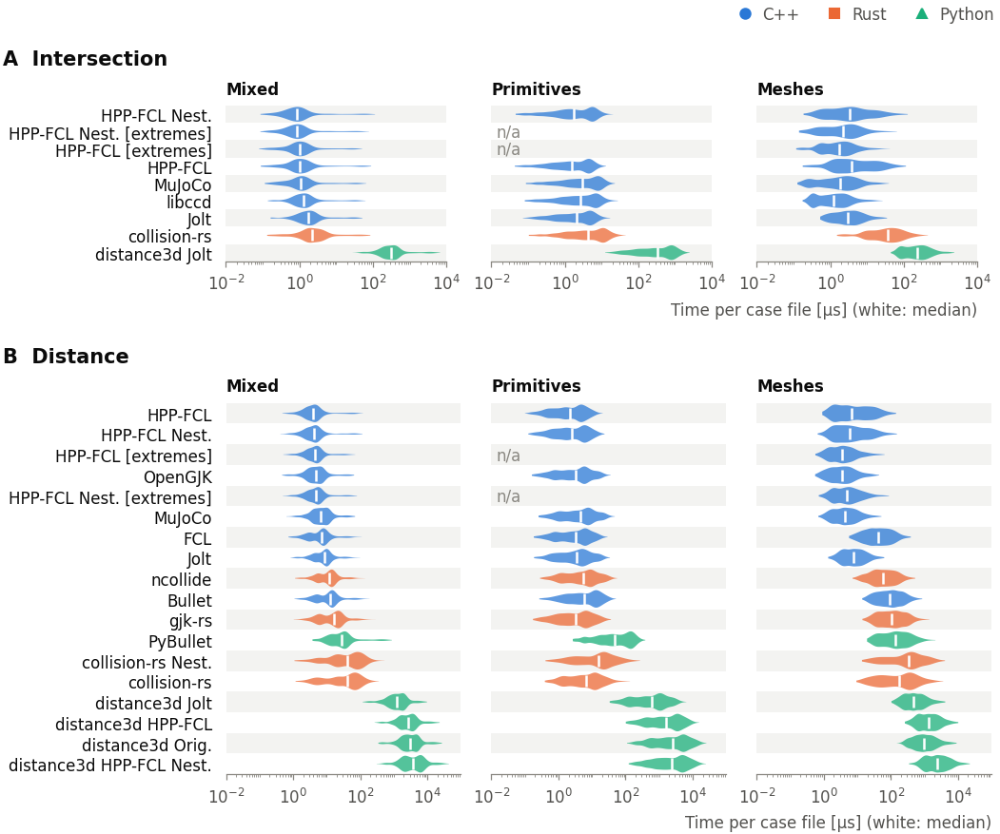
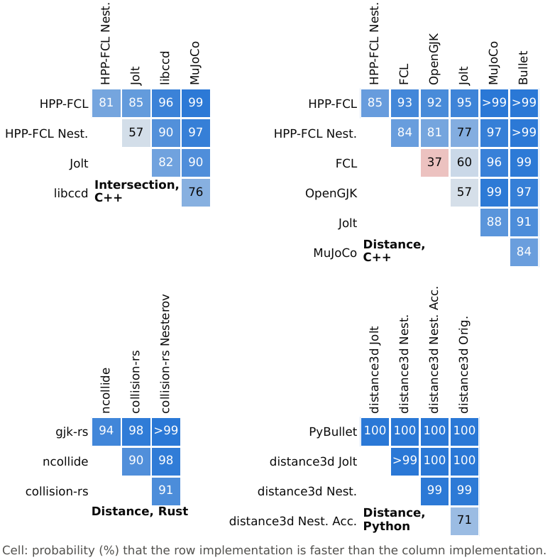
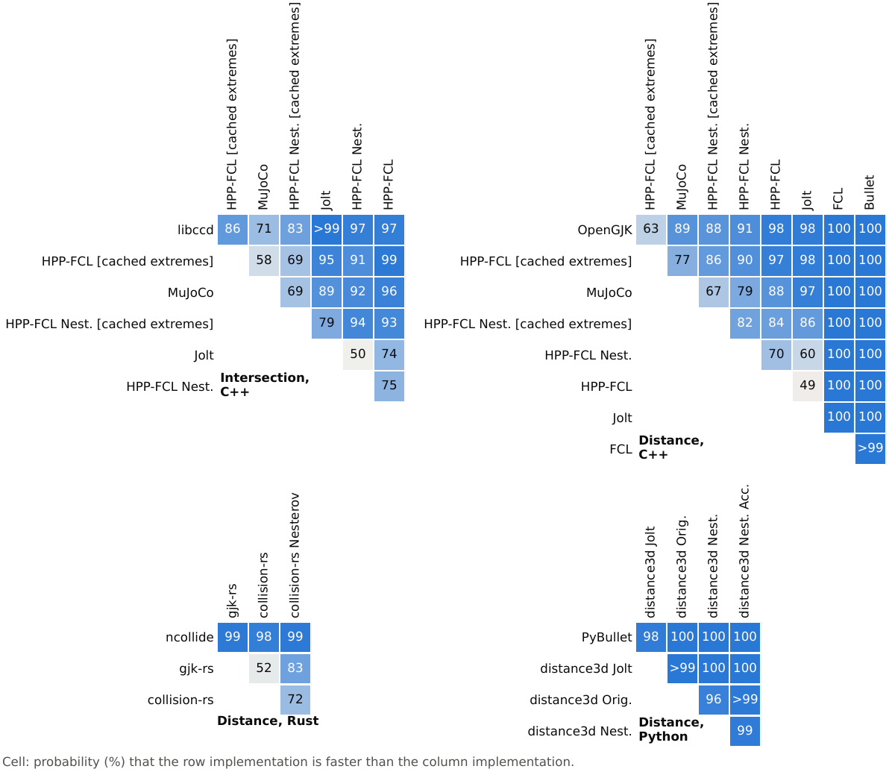
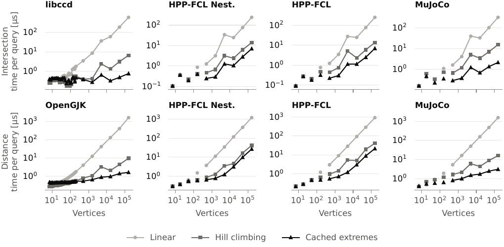

# Benchmarking Convex-Convex Collision Detection for Robotics

Thilo Umland $^1$,
Maarten Behn $^2$,
Alexander Fabisch $^2$

$^1$ University of Bremen,
Bibliothekstraße 1,
D-28359 Bremen,
Germany

$^2$ Robotics Innovation Center, DFKI GmbH,
Robert-Hooke-Straße 1,
D-28359 Bremen,
Germany

## Abstract
Collision detection and distance calculation is needed in simulation, planning, and control.
In particular, Gilbert-Johnson-Keerthi (GJK) and its variations are widely used.
We are interested in the question of how programming language, algorithm engineering, and implementation tricks influence its performance.
We develop a benchmark that resembles how GJK is used in a highly optimized collision detection pipeline for an arm with an anthropomorphic hand and compare the performance of commonly used implementations of GJK.
We analyze not just the moments of the distribution of runtimes, but the whole distribution, which is relevant for real-time applications.



## Folder-Structure
- [compare-cpp/README](./compare-cpp/README.md)
- [compare-rs/README](./compare-rs/README.md)
- [compare-python/README](./compare-python/README.md)
- [scripts/README](./scripts/README.md)

## Setup with Docker

The Docker image contains the system packages, Rust, and the conda environment `collision_env` with the Python
dependencies. The libraries are downloaded and built inside the repository, which is mounted into the container,
so builds and results stay on the host.

### 1. Build the image
```bash
docker buildx build -t compare .
```

### 2. Start a container
From the root of the repository:
```bash
docker run --mount type=bind,source=".",target="/collision-comparison" -e BENCHMARK_COMPUTER=PC1 --rm -it --entrypoint bash compare
cd /collision-comparison
```
The conda environment `collision_env` is activated automatically.
Replace `PC1` with a name for the computer: it is stored with the results (the host name of a container is random).
Alternatively, open the repository as a dev container (see `.devcontainer/devcontainer.json`).

### 3. Set up the repository
```bash
bash scripts/repo_setup.sh
```
This unpacks the benchmark data, downloads and builds the libraries, and compiles the C++ benchmark.
The script can be run again: existing data, repositories and builds are kept.

### 4. Generate additional benchmark case files (optional)
The case files of the benchmark "icospheres_of_different_high_vertex_counts" are too large for GitHub
(about 500 MiB), so they have to be generated. This benchmark is not part of the paper and is only needed if you
enable it in `scripts/setup_repo_and_start_all_benchmarks.sh`:
```bash
cd compare-python
PYTHONPATH=. python test_file/from_icospheres_of_different_high_vertex_counts.py
cd ..
```

### 5. Run the benchmarks
Run all benchmarks of the paper (about 6 hours on an Intel i7-10700KF). The script runs the setup, all benchmarks,
and compiles the results into CSV files. The benchmarks that are not part of the paper (dual-arm scene with at most
256 vertices and the icosphere benchmarks) are commented out in the script:
```bash
bash scripts/setup_repo_and_start_all_benchmarks.sh
```

To run only specific benchmarks, comment out the others in `scripts/setup_repo_and_start_all_benchmarks.sh`,
or run the scripts in `scripts/benchmarks` directly, e.g., `bash scripts/benchmarks/benchmark_uc1_ur10.sh`.
The results of each case file are stored in `results/<dataset>/<case file number>/`. Case files that already have
results are skipped, so an interrupted benchmark can simply be restarted and continues where it stopped.
Case files that failed (missing case file, crashed benchmark) are listed in `results/<dataset>/failures.log`, get no
results folder and are run again after a restart. To repeat a benchmark from scratch, delete its folder in `results/`.

To run only some implementations, e.g., to add an implementation to existing results, select the languages
(`BENCHMARK_LANGUAGES`, any of `cpp rust python`), the C++ and Rust benchmarks by name (`BENCHMARK_FILTER`, a regular
expression), and a separate results directory (`RESULTS_DIR`):
```bash
BENCHMARK_LANGUAGES=cpp BENCHMARK_FILTER="^FCL original" RESULTS_DIR=results_fcl \
    bash scripts/benchmarks/benchmark_dataset.sh uc1_ur10_collision 1 1000
```
The analysis merges the CSV files of the same benchmark and computer (see below).

## Results
Results on PC1 (2026-11-01), as in the paper. libccd and OpenGJK use an adaptive support function for meshes (see
the support function study), HPP-FCL is also shown with cached extremes in the dual-arm scene
([cached extremes]). The figures are written by `compare-python/analyze/run_analysis.py`,
`support_study.py`, and `case_statistics.py`.

**Benchmark data:** pairs per case file, share of intersecting pairs, and distance of separated pairs.



**Runtime distributions** per GJK implementation (time per case file, log scale): (A) primitives (use cases 1, 2,
5, and 6 with UR10 collision environment), (B) meshes (dual-arm scene).



**Slowdown relative to the fastest implementation** of the same query type (geometric mean of the paired ratios
with 95 % bootstrap confidence intervals): (A) primitives, (B) meshes.


**Probability of improvement** $P(T_{\text{row}} < T_{\text{column}})$ for pairs of implementations of the same
language and query type: primitives and meshes.




**Support function for meshes** on the icosphere benchmark: linear search, hill climbing, and hill climbing from
cached extreme vertices (as in MuJoCo).



### How many case files are done?
Number of finished case files per dataset:
```bash
for d in results/*/; do echo "$d $(ls "$d" | grep -c '^[0-9]*$')"; done
```

### Analyzing Results
Every benchmark writes a CSV file `<dataset>_<computer>_<timestamp>.csv` to the root of the repository. Every row
corresponds to one case file and contains the time for all collision checks of the case file in microseconds (median
of 10 repetitions after 10 warm-up runs) for every implementation, the number of collision checks, and, for the
icosphere sweeps, the number of faces and the distances.

The analysis checks the data quality, computes statistics of the runtime distributions with violin plots, and
compares implementations pairwise (paired probability of improvement and speedup with bootstrap confidence intervals):
```bash
cd compare-python/analyze
python run_analysis.py ../../<dataset>_<computer>_<timestamp>.csv [...] --results-dir ../../results --output analysis_output
```
Each CSV file is one task (one benchmark on one computer). CSV files of the same task from separate runs with
different implementations are merged by case file. The comparisons are computed separately for primitive
benchmarks (UR10 use cases) and mesh benchmarks (dual-arm scene, icospheres) and for each computer, and averaged over
the tasks of each group. `--results-dir` is only needed to check the warm-up with
the individual measured runs. See `python run_analysis.py --help` for the output files.
The old analysis scripts and notebooks are in `compare-python/analyze_backup`.

## Funding

This project has been developed initially at the Robotics Innovation Center
of the German Research Center for Artificial Intelligence (DFKI GmbH) in
Bremen. At this phase the work was supported through a grant from the European
Commission (870142).
Later, this work was partially supported by the German Federal Ministry of Research,
Technology and Space (BMFTR) under the Robotics Institute Germany (RIG) and partially
financed by the German Federal Ministry of Research, Technology and Space (BMFTR) through
the ActGPT project, grant number 01IW25002.


