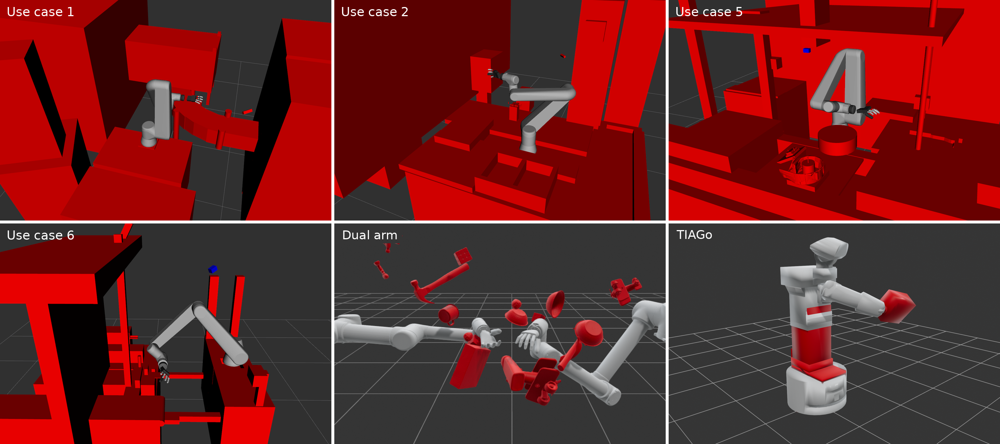
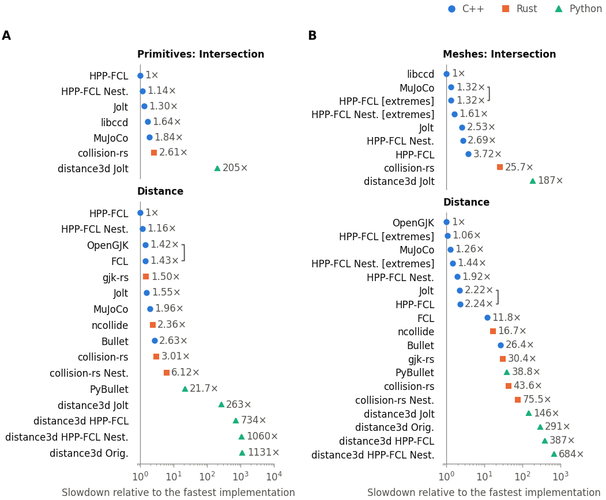
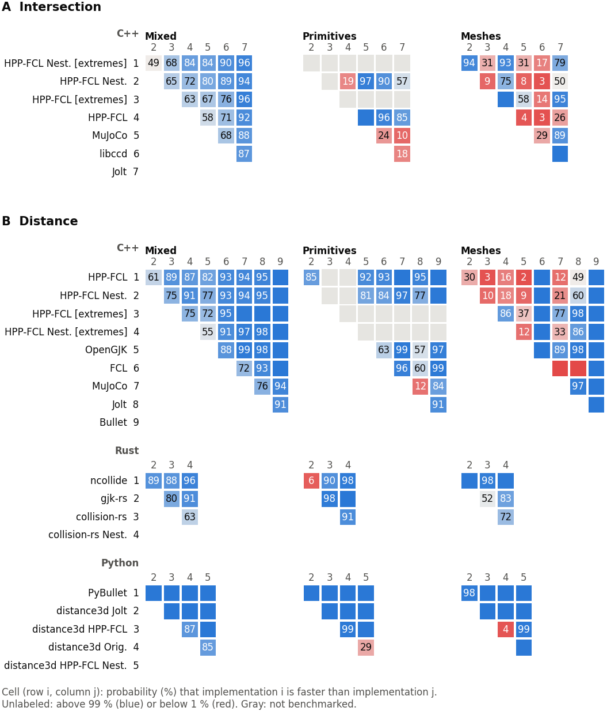

# Benchmarking Convex-Convex Collision Detection for Robotics: Implementation Matters More Than the Algorithm

Thilo Umland $^1$,
Maarten Behn $^2$,
Alexander Fabisch $^2$

$^1$ Robotics Research Group, University of Bremen, Bremen, Germany

$^2$ Robotics Innovation Center, German Research Center for Artificial Intelligence (DFKI GmbH), Bremen, Germany

## Abstract
Robots need collision detection and distance computation between convex shapes in simulation, motion planning, and control, with up to hundreds of pairs to check per control cycle at frequencies of up to 1 kHz. Most robotics libraries rely on the Gilbert-Johnson-Keerthi algorithm. New variants such as Nesterov acceleration promise faster queries. However, these variants are evaluated on synthetic shapes, so it remains unclear how much the algorithm matters in comparison to the programming language, the support function of the shapes, and the implementation. We benchmark twelve widely used and new implementations in C, C++, Rust, and Python on collision queries from realistic robot applications: four industrial use cases with primitive shapes as colliders, a dual-arm scene with meshes of YCB objects, and self-collision of a robot whose collision model combines primitive shapes and meshes. Since worst cases matter for real-time applications, we compare the full runtime distributions on identical queries.
Of all investigated factors, the algorithm matters least, since algorithm variants change the runtime by at most about a factor of two. Python implementations are one to three orders of magnitude slower than the fastest compiled ones, while C++ and Rust implementations perform similarly. On detailed meshes, hill climbing from cached extreme vertices is up to an order of magnitude faster than a linear search over all vertices and particularly shortens the tail of the runtime distribution. Implementations of the same algorithm differ by up to a factor of three. Hence, developers of robot software should choose collision libraries by the quality of their implementation and support mappings rather than by the algorithm, and our open benchmark enables algorithm designers to test new variants under realistic conditions.



## Folder-Structure
- [compare-cpp/README](./compare-cpp/README.md)
- [compare-rs/README](./compare-rs/README.md)
- [compare-python/README](./compare-python/README.md)
- [scripts/README](./scripts/README.md)

## Run all benchmarks of the paper

From the root of the repository (Docker may need `sudo`):
```bash
bash scripts/run_all_benchmarks_docker.sh PC1
```
Replace `PC1` with a name for the computer: it is stored with the results. The script builds the Docker image if
needed, then sets up the repository and runs all benchmarks of the paper in a container in the background, pinned to
one CPU core with high priority (see the script for options). This takes about 8 to 10 hours; the computer should be
idle meanwhile. Progress: `run_all_benchmarks.log` and `load.log`; results: `results/` and one CSV per benchmark in the
root of the repository. The steps are described in detail below.

## Setup with Docker

The Docker image contains the system packages, Rust, and the conda environment `collision_env` with the Python
dependencies. The libraries are downloaded and built inside the repository, which is mounted into the container,
so builds and results stay on the host.

### 1. Build the image
```bash
docker buildx build -t compare .
```

### 2. Start a container
From the root of the repository:
```bash
docker run --mount type=bind,source=".",target="/collision-comparison" -e BENCHMARK_COMPUTER=PC1 --rm -it --entrypoint bash compare
cd /collision-comparison
```
The conda environment `collision_env` is activated automatically.
Replace `PC1` with a name for the computer: it is stored with the results (the host name of a container is random).
Alternatively, open the repository as a dev container (see `.devcontainer/devcontainer.json`).

### 3. Set up the repository
```bash
bash scripts/repo_setup.sh
```
This unpacks the benchmark data, downloads and builds the libraries, and compiles the C++ benchmark.
The script can be run again: existing data, repositories and builds are kept.

### 4. Generate additional benchmark case files (optional)
The case files of the benchmark "icospheres_of_different_high_vertex_counts" are too large for GitHub
(about 500 MiB), so they have to be generated. This benchmark is not part of the paper and is only needed if you
enable it in `scripts/setup_repo_and_start_all_benchmarks.sh`:
```bash
cd compare-python
PYTHONPATH=. python test_file/from_icospheres_of_different_high_vertex_counts.py
cd ..
```

### 5. Run the benchmarks
Run all benchmarks of the paper (about 7.5 hours on an Intel i7-10700KF). The script runs the setup, all benchmarks,
and compiles the results into CSV files. The benchmarks that are not part of the paper (dual-arm scene with at most
256 vertices and the icosphere benchmarks) are commented out in the script:
```bash
bash scripts/setup_repo_and_start_all_benchmarks.sh
```

To run only specific benchmarks, comment out the others in `scripts/setup_repo_and_start_all_benchmarks.sh`,
or run the scripts in `scripts/benchmarks` directly, e.g., `bash scripts/benchmarks/benchmark_uc1_ur10.sh`.
The results of each case file are stored in `results/<dataset>/<case file number>/`. Case files that already have
results are skipped, so an interrupted benchmark can simply be restarted and continues where it stopped.
Case files that failed (missing case file, crashed benchmark) are listed in `results/<dataset>/failures.log`, get no
results folder and are run again after a restart. To repeat a benchmark from scratch, delete its folder in `results/`.

To run only some implementations, e.g., to add an implementation to existing results, select the languages
(`BENCHMARK_LANGUAGES`, any of `cpp rust python`), the C++ and Rust benchmarks by name (`BENCHMARK_FILTER`, a regular
expression), and a separate results directory (`RESULTS_DIR`):
```bash
BENCHMARK_LANGUAGES=cpp BENCHMARK_FILTER="^FCL original" RESULTS_DIR=results_fcl \
    bash scripts/benchmarks/benchmark_dataset.sh uc1_ur10_collision 1 1000
```
The analysis merges the CSV files of the same benchmark and computer (see below).

## Results
Results on PC1 (2026-11-01), as in the paper. libccd and OpenGJK use an adaptive support function for meshes (see
the support function study), HPP-FCL is also shown with cached extremes in the dual-arm and TIAGo scenes.
The figures are written by `compare-python/analyze/run_analysis.py`,
`support_study.py`, and `case_statistics.py`.

**Benchmark data:** pairs per case file, share of intersecting pairs, and distance of separated pairs.


**Support function for meshes** on the icosphere benchmark: linear search, hill climbing, and hill climbing from
cached extreme vertices (as in MuJoCo).


**Runtime distributions** per GJK implementation (time per case file, log scale): (A) intersection, (B) distance,
with the columns mixed (TIAGo self-collision), primitives (use cases 1, 2, 5, and 6 with UR10 collision environment),
and meshes (dual-arm scene). The rows are ordered by the median in the mixed benchmark.


**Slowdown relative to the fastest implementation** of the same query type (geometric mean of the paired ratios;
brackets join implementations whose 95 % bootstrap confidence interval of the paired speedup includes 1):
(A) intersection, (B) distance, with the columns mixed (TIAGo self-collision, PC1, 2026-11-06), primitives, and
meshes. The rows are ordered by the mixed benchmark; n/a: not benchmarked with this geometry.



**Probability of improvement** $P(T_{\text{row}} < T_{\text{column}})$ for pairs of implementations of the same
language and query type: (A) intersection, (B) distance, with the columns mixed, primitives, and meshes. All heatmaps
of a language show the implementations in the order of the slowdown in the mixed benchmark, so red cells show where
another benchmark reverses this order.



### How many case files are done?
Number of finished case files per dataset:
```bash
for d in results/*/; do echo "$d $(ls "$d" | grep -c '^[0-9]*$')"; done
```

### Analyzing Results
Every benchmark writes a CSV file `<dataset>_<computer>_<timestamp>.csv` to the root of the repository. Every row
corresponds to one case file and contains the time for all collision checks of the case file in microseconds (median
of 10 repetitions after 10 warm-up runs) for every implementation, the number of collision checks, and, for the
icosphere sweeps, the number of faces and the distances.

The analysis checks the data quality, computes statistics of the runtime distributions with violin plots, and
compares implementations pairwise (paired probability of improvement and speedup with bootstrap confidence intervals):
```bash
cd compare-python/analyze
python run_analysis.py ../../<dataset>_<computer>_<timestamp>.csv [...] --results-dir ../../results --output analysis_output
```
Each CSV file is one task (one benchmark on one computer). CSV files of the same task from separate runs with
different implementations are merged by case file. The comparisons are computed separately for primitive
benchmarks (UR10 use cases), mixed benchmarks with primitives and meshes (TIAGo self-collision), and mesh benchmarks
(dual-arm scene, icospheres) and for each computer, and averaged over
the tasks of each group. `--results-dir` is only needed to check the warm-up with
the individual measured runs. See `python run_analysis.py --help` for the output files.

## Citation

If you use this benchmark, please cite:

```bibtex
@article{Umland2026,
  title   = {Benchmarking Convex-Convex Collision Detection for Robotics: Implementation Matters More Than the Algorithm},
  author  = {Umland, Thilo and Behn, Maarten and Fabisch, Alexander},
  journal = {TODO},
  year    = {2026},
  doi     = {TODO}
}
```

## License

The code is licensed under the 3-clause BSD license, except for third-party code under its own license (see
[LICENSE](LICENSE)). In particular, the OpenGJK files in `compare-cpp/` are licensed under the GPL-3.0, so the
compiled C++ benchmark is distributed under the GPL-3.0.

## Funding

This project has been developed initially at the Robotics Innovation Center
of the German Research Center for Artificial Intelligence (DFKI GmbH) in
Bremen. At this phase the work was supported through a grant from the European
Commission (870142).
Later, this work was partially supported by the German Federal Ministry of Research,
Technology and Space (BMFTR) under the Robotics Institute Germany (RIG) and partially
financed by the German Federal Ministry of Research, Technology and Space (BMFTR) through
the ActGPT project, grant number 01IW25002.


